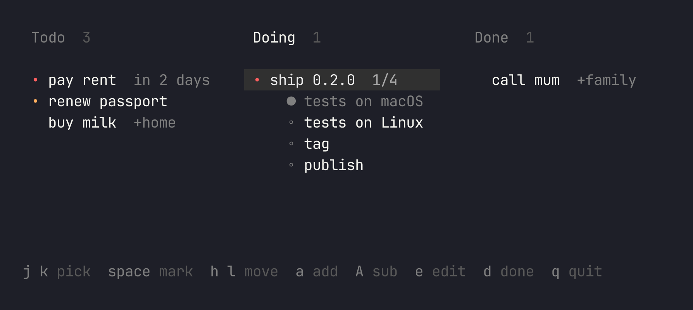

# halil

A small task manager for the terminal. You write tasks in plain words, the list puts what's due first, and a
board shows them as Todo, Doing and Done.



halil was built from an empty folder in one sitting with Claude in [tarae](https://github.com/tarae-sh/tarae).
Halfway, two Claudes worked side by side, each in its own checkout of this repository, and every change waited for
a yes before it was kept. Watch it in eleven minutes:
[Building a task manager with Claude, two at once](https://youtu.be/_GRlIMMMTmk). `start` and `edit` were written
after the sitting.

## Install

You need Rust 1.88 or newer.

```sh
cargo install halil
```

Or the latest from this repository: `cargo install --git https://github.com/tarae-sh/halil`.

## Use

```sh
halil add "pay rent friday 9am +home !high"
halil add call mom today 6pm +family
halil                 # the open tasks, what's due first
halil start 2         # to Doing
halil done 2
halil edit 1 next monday !med   # a new date and priority, the title kept
halil sub 1 transfer it friday  # a sub item under task 1
halil rm 1
halil board
```

`add` and `edit` read three things out of the words, and the rest is the title (`edit` keeps the old title when
no words are left):

- **A due date.** A day (`today`, `tomorrow`, `friday` or `fri`, `next friday`, `in 3 days`, `in a week`,
  `nov 20`, `2026-11-20`), a time (`9am`, `9:30pm`, `14:30`, `noon`, `eod`), or both (`in 2 hours`). A time on
  its own means the next time it comes. `at`, `by`, `on` or `due` before a date goes with it.
- **Tags**, as `+home`. `edit` takes one off with `-home`, when the task has it. When it hasn't, `-home` among
  other words is a word of the title, and `-home` alone is refused (`3 has no tag home`).
- **A priority**, as `!high`, `!med` or `!low`.

The list shows due dates in words from now (`today 6pm`, `tomorrow`, `fri`, `in 3w`, `2d late`), red when late.
`NO_COLOR` turns colour off.

### Sub items

A sub item is a task under another task, one level deep. `halil sub 3 write the tests friday` adds one under
task 3, with the words of `add`. It has an id of its own, so `start`, `done`, `edit` and `rm` work on it as on any
task.

The list shows a task's open sub items under it, indented, and how many are done after the task (`2/4`). An open
sub item of a done task is listed as a task of its own.

`halil done 3` finishes its open sub items too, and says how many. `halil rm 3` removes them with it. A task never
finishes by itself when its last sub item does.

### The board

| Key | |
|---|---|
| `j` `k`, `↓` `↑` | pick a card or a sub item, row by row |
| `g` `G` | the first or last row of the column |
| `space` | mark it, or unmark it, and step down |
| `h` `l` | move it to the column left or right; a sub item moves with its card only |
| `tab`, `←` `→` | go to another column |
| `a` | add a task, with the same words as `halil add` |
| `A` | add a sub item under the picked card (or the picked sub item's card) |
| `e` | change it, its title filled in, with the same words as `halil edit` |
| `d` | move it to Done, its open sub items with it; on a sub item, done or open again |
| `esc` | clear the marks, or quit when there are none |
| `q` | quit |

With marks, `h`, `l`, `d` and `e` act on all the marked at once, and `esc` clears them. `e` then takes a date,
`+tags`, `-tags` or a `!priority`, not a title.

Sub items show under their card, `◦` open and `●` done, and the card counts them (`2/4`). In Done they're folded
into the count. A card that goes to Done takes its open sub items with it, and one moved back out of Done
reopens none.

The footer shows the keys. When the window is narrow, `tab` gives way first, then `q`, then `j k`; `d` stays, and
on a sub item it says `d done/open`. With marks, the footer says how many are marked and the keys for them. After
`a`, `A` or `e`, it's where you type. The row above it says why a key did nothing, or what else a change did.

Every change is saved at once. A `halil add` from another terminal while the board is open shows up on it.

## Where tasks are kept

`$XDG_DATA_HOME/halil/tasks.jsonl`, or `~/.local/share/halil/tasks.jsonl`: one JSON object a line, rewritten
whole on each save (written beside it, then renamed over it). A sub item has `"parent": <id>`; one whose parent
is gone shows as a task of its own.

## License

MIT or Apache-2.0, at your choice.
